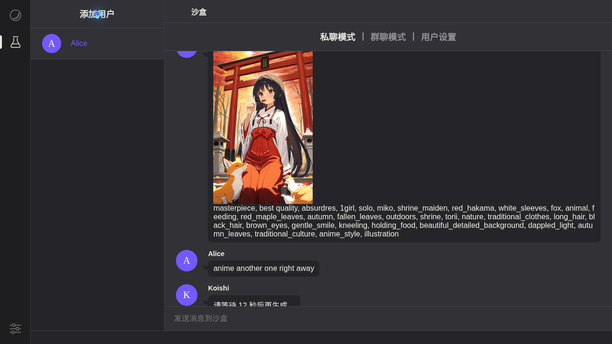

# koishi-plugin-animeapi

[Koishi](https://koishi.chat) ボット向けのアニメ画像生成プラグインです。[AnimeAPI](https://animeapi.ai) を利用します。AnimeAPI は最安クラスのアニメ画像 API です：**1 枚 $0.003**、プリペイド残高は $5 から・無期限、サブスクリプションなし。新規アカウントは無料 3 枚、カード不要。

[English](README.md) · [简体中文](README.zh-CN.md) · **日本語**



## インストール

Koishi コンソールの **プラグインマーケット** で `animeapi` を検索してインストールします。または、ボットのフォルダで：

```sh
npm install koishi-plugin-animeapi
```

プラグインを有効にし、<https://animeapi.ai/dashboard/api-keys> で作成した API キー（`ank_` で始まる）を入力します。

## 使い方

```
anime 雨のバス停で赤い傘をさす少女
anime -o landscape 秋の神社、舞い落ちる紅葉
anime -m ultra a cafe chalkboard that reads OPEN LATE
```

プロンプトは普通の文章で構いません。AnimeAPI が anime モデル用のタグに書き換えます。コマンドの別名：`animeapi`。

## 設定

| 設定 | 既定 | 説明 |
| --- | --- | --- |
| `apiKey` | 空 | AnimeAPI のキー |
| `model` | `anime` | 1 枚 `anime` $0.003、`ultra` $0.01、`ultra-max` $0.02 |
| `orientation` | `portrait` | `portrait`（縦）、`square`（正方形）、`landscape`（横）。価格は同じ |
| `enhance` | `true` | プロンプトをタグに自動変換（anime モデル） |
| `cooldown` | `30` | ユーザーごとの生成間隔（秒）。`0` で無効 |
| `allowModelOverride` | `false` | ユーザーが `-m` でモデルを選べるようにします。高価なモデルを選ばれないよう既定でオフ |
| `showPrompt` | `false` | モデルが受け取ったタグも送信 |
| `sendAs` | `file` | `file` は画像をダウンロードして送信、`url` はリンクを送信 |
| `timeout` | `120` | AnimeAPI の応答を待つ秒数 |

AnimeAPI は成人向けコンテンツを生成しません。露骨なプロンプトは拒否され、課金されません。

リクエストは Koishi の HTTP サービス経由なので、Koishi で設定したプロキシが使われます。

## ユーザーに表示されるメッセージ

| 状況 | 返信 |
| --- | --- |
| 残高なし | 管理者に <https://animeapi.ai/dashboard/billing> でのチャージを案内 |
| キーが無効・失効 | 管理者にキーの確認を案内 |
| モデルがプロンプトを拒否 | 理由を表示。課金されません |
| クールダウン中 | 残り秒数を表示 |
| AnimeAPI が混雑 | 数秒後の再試行を案内。失敗した画像は返金されます |

返信は English・简体中文・日本語に対応し、ユーザーの Koishi 言語設定に従います。

## リンク

- AnimeAPI：<https://animeapi.ai> · [ドキュメント](https://animeapi.ai/docs) · [API リファレンス](https://animeapi.ai/docs/api-reference)
- ライセンス：[MIT](LICENSE)
