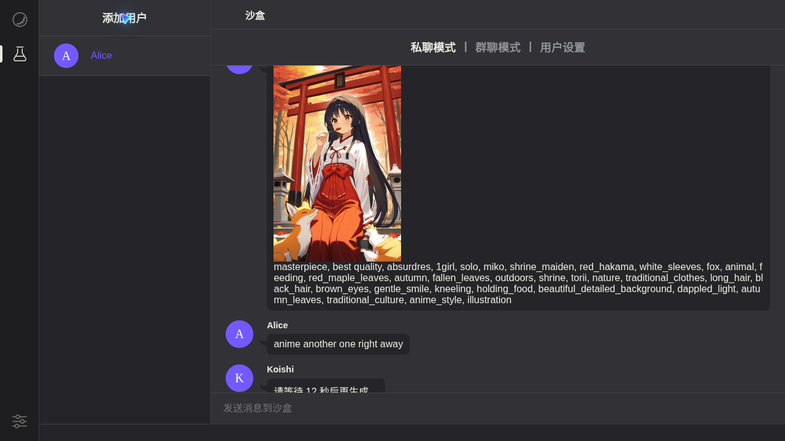

# koishi-plugin-animeapi

Anime image generation for [Koishi](https://koishi.chat) bots, powered by [AnimeAPI](https://animeapi.ai), one of the cheapest anime image APIs: **$0.003 per image**, prepaid balance from $5 that never expires, no subscription. New accounts get 3 free images, no card needed.

**English** · [简体中文](README.zh-CN.md) · [日本語](README.ja.md)



## Install

In the Koishi console open **Plugin Market**, search for `animeapi` and install it. Or from a terminal in your bot's folder:

```sh
npm install koishi-plugin-animeapi
```

Then enable the plugin and paste your API key (starts with `ank_`) from <https://animeapi.ai/dashboard/api-keys>.

## Use

```
anime a girl with a red umbrella at a rainy bus stop
anime -o landscape a shrine in autumn, falling leaves
anime -m ultra a cafe chalkboard that reads OPEN LATE
```

Write the prompt in plain words; AnimeAPI rewrites it into tags for the anime model. `animeapi` is an alias for the command.

## Settings

| Setting | Default | What it does |
| --- | --- | --- |
| `apiKey` | empty | Your AnimeAPI key |
| `model` | `anime` | `anime` $0.003, `ultra` $0.01, `ultra-max` $0.02 per image |
| `orientation` | `portrait` | `portrait`, `square` or `landscape`; same price |
| `enhance` | `true` | Rewrite plain prompts into tags (anime model) |
| `allowNSFW` | **`false`** | NSFW output is off by default. Flagged images are refused and refunded instead of being sent to the chat |
| `cooldown` | `30` | Seconds each user must wait between images; `0` disables the limit |
| `allowModelOverride` | `false` | Let users choose a model with `-m`. Off so users cannot pick a more expensive model |
| `showPrompt` | `false` | Also send the tags the model received |
| `sendAs` | `file` | `file` downloads the image and sends it; `url` sends the link |
| `timeout` | `120` | Seconds to wait for AnimeAPI |

Requests go through Koishi's own HTTP service, so the proxy you set in Koishi applies.

## Messages your users may see

| Situation | Reply |
| --- | --- |
| Balance is empty | Tells the bot owner to add funds at <https://animeapi.ai/dashboard/billing> |
| Key is wrong or revoked | Tells the bot owner to check the key |
| The model refused the prompt | Shows the reason; nothing is charged |
| Too soon after the last image | Shows how many seconds are left |
| AnimeAPI is busy | Asks to try again in a few seconds; failed images are refunded |

Replies are available in English, 简体中文 and 日本語 and follow the user's Koishi language.

## Links

- AnimeAPI: <https://animeapi.ai> · [Docs](https://animeapi.ai/docs) · [API reference](https://animeapi.ai/docs/api-reference)
- Licence: [MIT](LICENSE)
