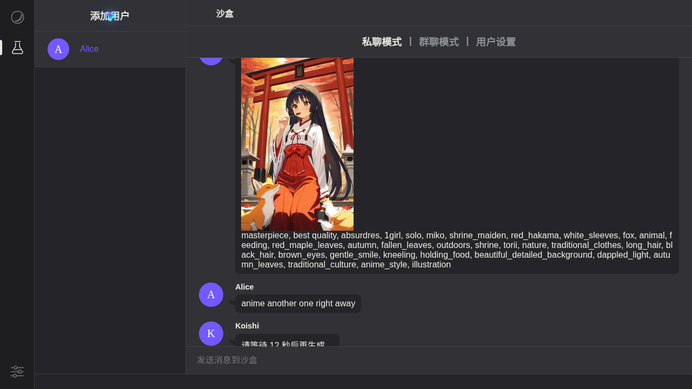

# koishi-plugin-animeapi

为 [Koishi](https://koishi.chat) 机器人提供动漫图片生成，由 [AnimeAPI](https://animeapi.ai) 驱动。AnimeAPI 是最便宜的动漫图片 API 之一：**每张 $0.003**，预付余额 $5 起、永不过期，无订阅。新账号免费 3 张，无需绑卡。

[English](README.md) · **简体中文** · [日本語](README.ja.md)



## 安装

在 Koishi 控制台打开 **插件市场**，搜索 `animeapi` 并安装。或在机器人目录下执行：

```sh
npm install koishi-plugin-animeapi
```

然后启用插件，填入 API 密钥（以 `ank_` 开头），密钥在 <https://animeapi.ai/dashboard/api-keys> 创建。

## 使用

```
anime 雨天公交站打着红伞的女孩
anime -o landscape 秋天的神社，落叶纷飞
anime -m ultra a cafe chalkboard that reads OPEN LATE
```

直接用自然语言描述即可，AnimeAPI 会自动改写为 anime 模型使用的标签。指令别名：`animeapi`。

## 配置项

| 配置 | 默认 | 说明 |
| --- | --- | --- |
| `apiKey` | 空 | AnimeAPI 密钥 |
| `model` | `anime` | 每张 `anime` $0.003、`ultra` $0.01、`ultra-max` $0.02 |
| `orientation` | `portrait` | `portrait`（竖）、`square`（方）、`landscape`（横），价格相同 |
| `enhance` | `true` | 自动把提示词改写为标签（anime 模型） |
| `cooldown` | `30` | 每位用户两次生成之间的间隔（秒），`0` 为不限制 |
| `allowModelOverride` | `false` | 是否允许用户用 `-m` 选择模型。默认关闭，避免用户选用更贵的模型 |
| `showPrompt` | `false` | 同时发送模型实际收到的标签 |
| `sendAs` | `file` | `file` 下载后发送图片文件；`url` 直接发送链接 |
| `timeout` | `120` | 等待 AnimeAPI 的秒数 |

AnimeAPI 不生成成人内容。露骨的提示词会被拒绝，且不收费。

请求通过 Koishi 自带的 HTTP 服务发出，因此会使用你在 Koishi 中配置的代理。

## 用户可能看到的提示

| 情况 | 回复 |
| --- | --- |
| 余额不足 | 提示管理员前往 <https://animeapi.ai/dashboard/billing> 充值 |
| 密钥无效或已撤销 | 提示管理员检查密钥 |
| 模型拒绝了提示词 | 显示原因，不扣费 |
| 冷却中 | 显示剩余秒数 |
| AnimeAPI 繁忙 | 提示稍后重试；失败的图片会退款 |

回复支持 English、简体中文、日本語，跟随用户在 Koishi 中的语言设置。

## 链接

- AnimeAPI：<https://animeapi.ai> · [文档](https://animeapi.ai/docs) · [API 参考](https://animeapi.ai/docs/api-reference)
- 许可证：[MIT](LICENSE)
